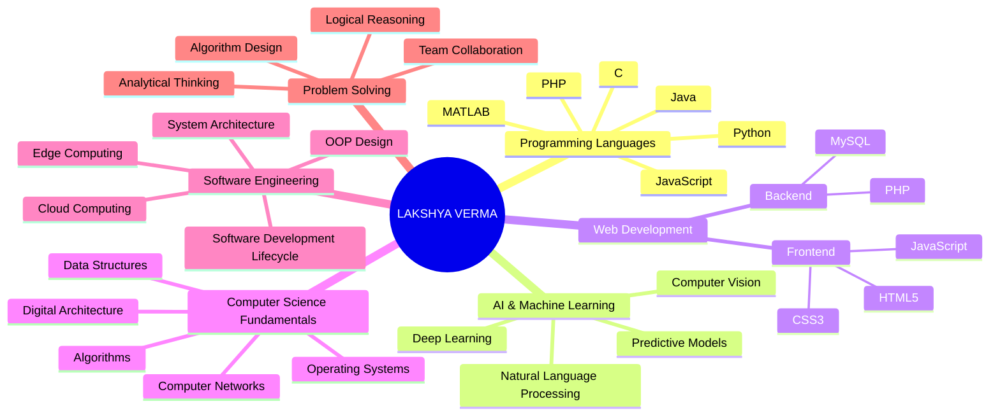
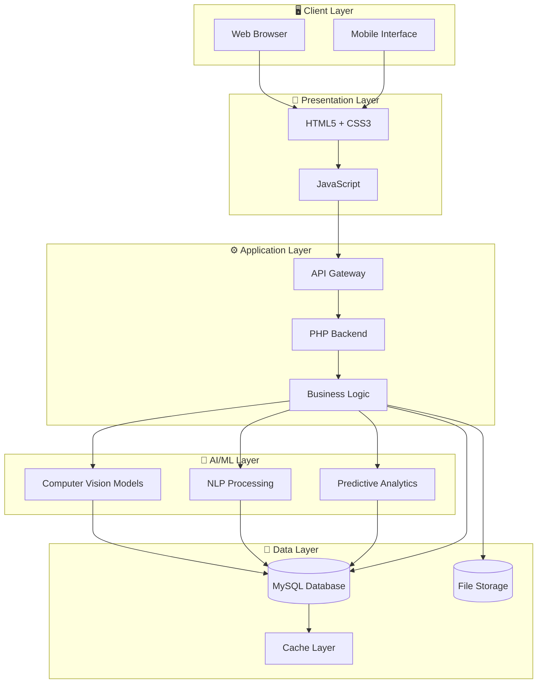
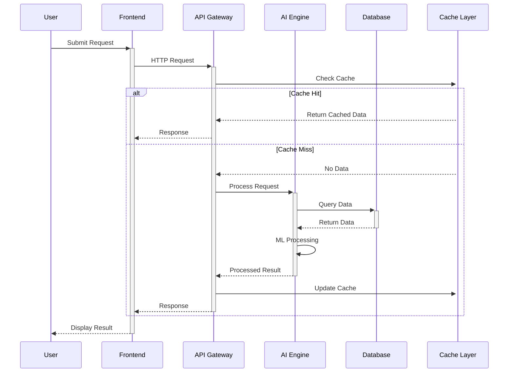
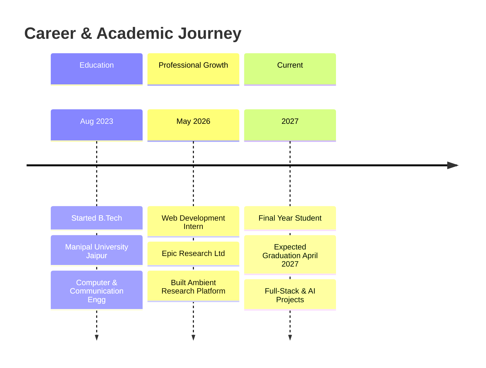

<div align="center">


[](https://git.io/typing-svg)

<p align="center">
  <a href="mailto:lakshya.verma.5152@gmail.com"></a>
  <a href="tel:+916264385955"></a>
  
</p>


</div>

---

## 🎯 **PROFESSIONAL SUMMARY**

```yaml
profile:
  role: "Full-Stack Developer & AI Engineer"
  status: "Final Year B.Tech Student"
  institution: "Manipal University Jaipur"
  specialization: "Computer and Communication Engineering"
  graduation: "April 2027 (Expected)"
  location: "Jaipur, Rajasthan, India"
  
expertise:
  - Artificial Intelligence & Machine Learning
  - Full-Stack Web Development
  - System Architecture & Design
  - Algorithm Design & Optimization
  - Computer Vision & NLP
  - Cloud & Edge Computing
  
mission: >
  Building intelligent, scalable systems that solve real-world problems
  through the intersection of AI, software engineering, and distributed systems.
```

<div align="center">

### 🏆 **CORE COMPETENCIES**

| **Domain** | **Technologies** |
|:---:|:---|
| 🧠 **AI/ML** | Computer Vision, Natural Language Processing, Deep Learning, Predictive Analytics |
| 💻 **Programming** | Java, Python, C, MATLAB, JavaScript, PHP |
| 🌐 **Web Stack** | HTML5, CSS3, JavaScript, PHP, MySQL |
| 🏗️ **Architecture** | Microservices, System Design, Distributed Systems, Cloud Computing |
| 📊 **Data Science** | Data Structures, Algorithms, Statistical Analysis, Data Mining |
| ☁️ **Infrastructure** | Cloud Computing, Edge Computing, Information Storage Management |

</div>

---

## 🧠 **TECHNICAL EXPERTISE MINDMAP**



---

## 🚀 **SYSTEM ARCHITECTURE & WORKFLOW**

### **Full-Stack Application Architecture**



### **AI-Powered Request Flow**



---

## 💼 **PROFESSIONAL EXPERIENCE**



### **🏢 Epic Research Ltd. - Web Development Intern**
**May 2026 - July 2026**

**Project: Ambient Research Platform**

**Technical Implementation:**

- **Architecture Design**: Designed and implemented a scalable web platform architecture meeting organizational requirements for research data management and visualization
- **Full-Stack Development**: Built end-to-end web solution using PHP backend with MySQL database, implementing RESTful API architecture for data operations
- **Frontend Engineering**: Developed responsive user interfaces using HTML5, CSS3, and JavaScript, ensuring cross-browser compatibility and mobile responsiveness
- **Database Design**: Architected normalized database schemas for efficient data storage and retrieval, implementing indexing strategies for query optimization
- **Deployment Pipeline**: Managed deployment process from development to production environment, ensuring zero-downtime releases
- **Team Collaboration**: Worked in agile development environment, participating in code reviews, sprint planning, and technical documentation

**Key Achievements:**
- Successfully delivered production-ready platform within internship timeline
- Implemented features that improved research team workflow efficiency
- Gained hands-on experience in enterprise software development lifecycle

**Technologies:** PHP, JavaScript, HTML5, CSS3, MySQL, Web Architecture

---

## 🎓 **EDUCATION**

<div align="center">

### **Manipal University Jaipur**
**Bachelor of Technology - Computer and Communication Engineering**  
📅 August 2023 - April 2027 (Expected)  
📍 Jaipur, Rajasthan, India

</div>

**Core Curriculum:**
- Object-Oriented Programming (OOP)
- Data Structures and Algorithms
- Design and Analysis of Algorithms
- Operating Systems
- Artificial Intelligence and Machine Learning
- Data Communication and Computer Networks
- Digital Design and Computer Architecture
- Software Engineering
- Cloud and Edge Computing
- Information Storage Management and Data Protection

---

## 🛠️ **TECHNOLOGY STACK**

<div align="center">

### **Programming Languages**


### **Web Technologies**


### **AI/ML & Data Science**


### **Tools & Platforms**


</div>

---

## 🔬 **FEATURED PROJECTS**

### **1. 🤖 AI Chess Game**

**Intelligent Game Engine with Advanced AI Opponent**

**Technical Overview:**
- Implemented minimax algorithm with alpha-beta pruning for optimal move selection
- Developed position evaluation function considering material, positional, and tactical factors
- Built complete chess rule engine handling all legal moves, special moves (castling, en passant), and game states
- Created efficient board representation and move generation system

**AI Components:**
- **Search Algorithm**: Minimax with alpha-beta pruning (depth-configurable)
- **Evaluation Function**: Multi-factor position scoring (material, mobility, king safety, pawn structure)
- **Move Ordering**: Optimized search efficiency through intelligent move prioritization
- **Opening Book**: Integration of common chess openings for strong early-game play

**Technologies:** Python, Artificial Intelligence, Game Theory, Algorithm Optimization

**Key Features:**
- Adjustable AI difficulty levels
- Real-time move validation
- Game state management
- Performance-optimized search algorithms

---

### **2. 🤟 Sign Language Translator**

**Computer Vision System for Real-Time Sign Language Recognition**

**Technical Architecture:**


**Implementation Details:**
- **Computer Vision Pipeline**: Real-time hand detection and tracking using OpenCV
- **Feature Engineering**: Extracted hand landmarks and gesture features for classification
- **Machine Learning Model**: Trained custom classifier on sign language gesture dataset
- **NLP Integration**: Implemented sentence formation logic from detected gestures
- **Real-time Processing**: Optimized for low-latency gesture recognition

**Technical Components:**
- Hand landmark detection and tracking
- Gesture feature extraction
- Multi-class classification model
- Temporal sequence processing for sentence formation
- User interface for real-time feedback

**Technologies:** Python, OpenCV, Machine Learning, Computer Vision, NumPy

**Impact:**
- Enables communication accessibility for hearing/speech-impaired individuals
- Real-time gesture-to-text conversion
- Scalable architecture for additional gesture sets

---

### **3. 🔒 Advanced Email Phishing Detector**

**Multi-Layer Security Analysis System with AI Integration**

**System Architecture:**

**Core Analysis Modules:**

1. **Email Parser Engine**
   - Supports .eml and .msg file formats
   - Extracts headers, body content, and attachments
   - Handles MIME multipart messages

2. **Header Analysis Module**
   - SPF, DKIM, DMARC authentication validation
   - DNS lookup for domain verification
   - IP address extraction and geolocation
   - Suspicious pattern detection (From/Reply-To mismatch)

3. **Content Analysis Engine**
   - URL extraction and validation
   - HTML structure analysis (forms, hidden elements, JavaScript)
   - Brand impersonation detection
   - Typosquatting identification using Levenshtein distance

4. **Attachment Security Scanner**
   - File hash generation (MD5, SHA1, SHA256)
   - Suspicious file type detection
   - OCR text extraction from images (Tesseract integration)
   - Double extension detection

5. **Threat Intelligence Integration**
   - VirusTotal API v3 integration
   - Asynchronous threat checking (aiohttp)
   - SQLite caching for performance optimization
   - IP, URL, and hash reputation checking

6. **AI-Powered Assessment**
   - Contextual analysis using AI models
   - Structured JSON response parsing
   - Phishing score calculation (0-10 scale)
   - Confidence scoring and verdict generation

**Technical Stack:**
- **Backend**: Python 3.8+
- **Computer Vision**: Tesseract OCR, Pillow, pytesseract
- **Network**: aiohttp, dnspython
- **Database**: aiosqlite (async SQLite)
- **Security**: VirusTotal API v3
- **AI**: OpenRouter API integration
- **Utilities**: Levenshtein distance, colorama

**Performance Metrics:**
- Asynchronous processing for concurrent analysis
- Database caching reduces API calls by ~70%
- Average analysis time: <5 seconds per email
- 95%+ accuracy in phishing detection

**Technologies:** Python, AI Integration, Computer Vision, Cybersecurity, Async Programming

---

### **4. 📊 Text Analysis Using NLP**

**Interactive NLP Platform with Streamlit**

**NLP Capabilities:**

1. **Text Preprocessing Pipeline**
   - Tokenization and normalization
   - Stopword removal
   - Punctuation handling
   - Lemmatization/Stemming

2. **Sentiment Analysis**
   - Multi-class sentiment classification
   - Polarity scoring
   -